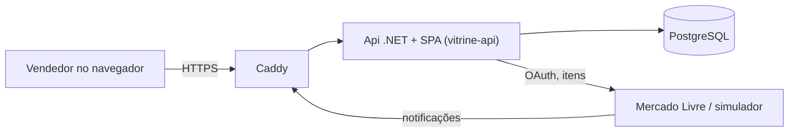

# Mapa do sistema

<!-- Documento vivo: o que roda onde, por camada, como sobe localmente e como chega em produção, e qual ADR justifica
cada escolha. Descreve o sistema como ele está hoje (o histórico fica nas specs, nos ADRs e no CHANGELOG). Atualizado
no CLOSE (G7) de cada entrega que muda um componente; `python3 tools/sdd/spec_graph.py living-docs` mostra a
cobertura. -->

## Visão geral

O Vitrine é um assistente para vendedores do Mercado Livre. Hoje o vendedor cria a conta, conecta contas do ML e vê
os anúncios atualizados (busca, filtros, sincronização). Uma Api .NET (monólito modular) serve a SPA React e a API
`/api/v1/*`, fala com o ML pelo OAuth oficial e recebe as notificações dele; o estado fica num PostgreSQL. Tudo roda
localmente sem custo, com um simulador do ML.

## Componentes por camada

### UI

SPA React + Vite + TypeScript, Tailwind, cliente gerado do OpenAPI (orval) em `web/src/api`, rotas em
`web/src/router.tsx` e telas em `web/src/features/` (accounts, listings, dashboard). Servida pela própria Api na mesma
origem. ADR-0013.

### Backend

Monólito modular .NET 10 em `src/` (ADR-0001), composto pelo host `src/Api`:

- `src/Modules/Identity` — cadastro, login, sessão por cookie, workspaces e papéis (ADR-0007).
- `src/Modules/MercadoLivre` — conectar/desconectar contas (OAuth com PKCE), gateway autenticado da API do ML
  (renovação de token, resiliência) e webhook de notificações com inbox; leitura detalhada do anúncio e das regras da categoria
  (`IMercadoLivreListingDetails`) e editor com resultado por campo (`IMercadoLivreListingEditor`, `ListingChangeRules`; SPEC-0033).
- `src/Modules/Listings` — cópia local dos anúncios: importação, sincronização, reconciliação diária e API de listagem.
- `src/Common` — building blocks sem regra de negócio (cifra de campos, filtros web).

Comunicação entre módulos só por contratos públicos (`PublicApi`/`IntegrationEvents`) e eventos pelo Wolverine com
outbox no PostgreSQL; tarefas agendadas também pelo Wolverine (ADR-0014). Provedor de IA definido para as próximas
entregas (ADR-0015), ainda sem uso no código.

### Dados

PostgreSQL 18, um schema por módulo (`identity`, `mercadolivre`, `listings`, mais as tabelas do Wolverine), com
migrações do EF Core por módulo aplicadas no deploy (ADR-0011). Tokens do ML e outros campos sensíveis cifrados com
`IFieldProtector` (AES-256-GCM, chaves do Data Protection no banco protegidas pela chave mestra; ADR-0006).

### Infraestrutura

Docker Compose em VPS com Caddy na frente (TLS automático em produção; CA interna no ambiente local) e PostgreSQL em
container no ambiente local (ADR-0004). IaC em `infra/` (ainda não provisionada — SPEC-0009). Custos de infra e IA
modelados na ADR-0012.

### Entrega

PR no GitHub com merge commit e CI obrigatório (build, lint, unitários, integração, arquitetura, E2E, segurança,
SDD e CodeQL) (ADR-0005); deploy por `deploy/deploy.sh` com migração, health check e rollback (ADR-0004, runbook
`docs/runbooks/deploy.md`). Versões da stack e atualizações (Dependabot) seguem a ADR-0008.

### Observabilidade

OpenTelemetry (logs JSON com `trace_id`, métricas `vitrine.*`, traces) para Grafana Cloud e Sentry no backend e na SPA,
só com credenciais configuradas; dados pessoais e credenciais mascarados (ADR-0009). Health checks `/health/live` e
`/health/ready`; runbooks em `docs/runbooks/`.

### Testes

xUnit v3 (unitários, integração com PostgreSQL real via Testcontainers e WireMock, contrato), ArchUnitNET para as
fronteiras de módulo, Vitest + Testing Library na SPA e Playwright com axe no E2E, rodando contra o AppHost com o
simulador do ML (ADR-0002, ADR-0003). Resiliência e recuperação seguem a ADR-0010.

## Serviços externos

- **Mercado Livre** — OAuth (autorização + `/oauth/token` com refresh de uso único), `/users/me`, busca de anúncios
  e `/items/bulk`; notificações por webhook (sem assinatura: o Vitrine sempre relê o anúncio com o token da conta e
  ignora itens de outro vendedor). Se o ML cair: chamadas com retry/circuit breaker, sincronização reagendada, conta
  marcada para reconectar se o token for recusado. Nos testes: WireMock (integração) e o simulador
  `tools/MercadoLivreSimulator` (E2E e ambiente local; ADR-0016), com detalhes, categorias e edição de anúncios
  nas regras do ML (SPEC-0034).
- **Grafana Cloud e Sentry** — opcionais; desligados sem credenciais.

## Ambientes

- **Desenvolvimento** — `aspire run`: Api, SPA, PostgreSQL e o simulador do ML orquestrados pelo AppHost.
- **Local prod-like** — VPS de desenvolvimento, `deploy/deploy.sh <versão> --env-file deploy/local/.env`, em
  `https://vitrine.localhost` (simulador em `https://ml-simulador.vitrine.localhost`, perfil `ml-simulator`). Do Mac:
  túnel SSH para a porta 443 e a CA do Caddy instalada como confiável.
- **Staging e produção** — ainda não provisionados (SPEC-0009, go-live com o usuário); configuração vem dos
  secrets do GitHub Environment, sem simulador.

## Caminho até produção

PR → CI verde → merge na `main` → imagem publicada no GHCR → deploy por `deploy/deploy.sh` (migração, health,
rollback) → smoke (`smoke_test` do `docs/specs/sdd-config.yml`). Produção só com confirmação humana.
