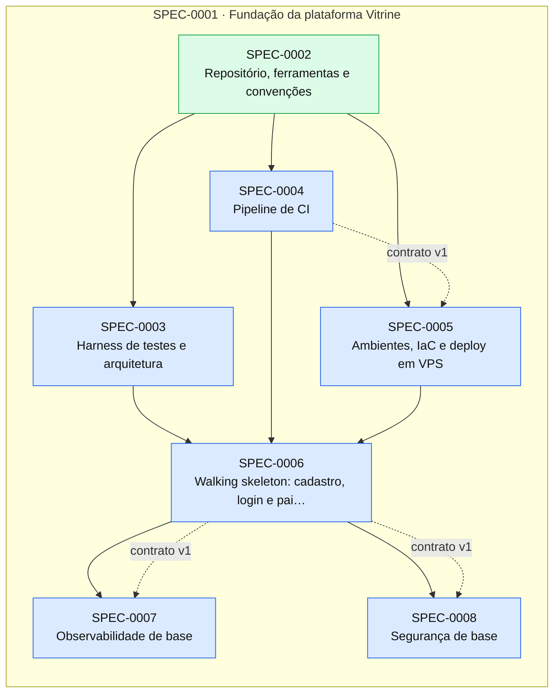

# Índice de Specs

> Gerado por `spec_graph.py index` em 2026-10-13 — não edite manualmente.

## Saúde

- Validação (G0): **0 erro(s), 1 aviso(s)** — rode `spec_graph.py validate`
- Specs: approved 6, implemented 1
- Impedimentos: **0 aberto(s)**, 0 resolvido(s)

## Cobertura de Pilares

Perfil: **padrao**

| Pilar | Situação | Detalhe |
|---|---|---|
| Arquitetura e fronteiras | coberto | ADR-0001 |
| Estratégia de testes | coberto | ADR-0002 |
| Qualidade de código | coberto | ADR-0003 |
| Entrega contínua e ambientes | coberto | ADR-0004 |
| Fluxo de mudança | coberto | ADR-0005 |
| Segredos e dados sensíveis | coberto | ADR-0006 |
| Identidade e acesso | coberto | ADR-0007 |
| Dependências e ciclo de vida da stack | coberto | ADR-0008 |
| Observabilidade | coberto | ADR-0009 |
| Resiliência e recuperação | coberto | ADR-0010 |
| Dados e migrações | coberto | ADR-0011 |
| Custo | coberto | ADR-0012 |

## Jornadas Críticas

| Jornada | Situação | Specs |
|---|---|---|
| Vendedor se cadastra, entra e vê o painel | planejada | SPEC-0006 |

## Plano de Execução

**Em andamento:** —  
**Paradas por impedimento:** —  
**Próximo lote:** SPEC-0003, SPEC-0004, SPEC-0005

| Onda | Spec | Título | Tier/Tam. | Status | Prontidão | Observação |
|---|---|---|---|---|---|---|
| 1 | SPEC-0003 | Harness de testes e arquitetura | full/M | approved | ✅ pronta |  |
| 1 | SPEC-0004 | Pipeline de CI | full/M | approved | ✅ pronta |  |
| 1 | SPEC-0005 | Ambientes, IaC e deploy em VPS | full/M | approved | ✅ pronta |  |
| 2 | SPEC-0006 | Walking skeleton: cadastro, login e painel vazio | full/M | approved | ⛔ aguarda implementação de SPEC-0003; aguarda implementação de SPEC-0004; aguarda implementação de SPEC-0005 |  |
| 3 | SPEC-0007 | Observabilidade de base | full/M | approved | ⛔ aguarda implementação de SPEC-0006 |  |
| 4 | SPEC-0008 | Segurança de base | full/M | approved | ⛔ aguarda implementação de SPEC-0006 | saiu da onda 3: arquivos em comum com SPEC-0007 |

## Épicos

| Épico | Título | Status | Progresso |
|---|---|---|---|
| SPEC-0001 | Fundação da plataforma Vitrine | approved | 1/7 implementadas |

## Grafo de Dependências

Seta contínua: depende da implementação. Seta tracejada: consome contrato.

## Todas as Specs

| ID | Título | Tier | Tipo | Status | Criada | Épico | Depende de | Consome contrato |
|---|---|---|---|---|---|---|---|---|
| [SPEC-0001](SPEC-0001-fundacao-da-plataforma-vitrine.md) | Fundação da plataforma Vitrine | epic | foundation | approved | 2026-10-13 | — | — | — |
| [SPEC-0002](SPEC-0002-repositorio-ferramentas-e-convencoes.md) | Repositório, ferramentas e convenções | full | foundation | implemented | 2026-10-13 | SPEC-0001 | — | — |
| [SPEC-0003](SPEC-0003-harness-de-testes-e-arquitetura.md) | Harness de testes e arquitetura | full | foundation | approved | 2026-10-13 | SPEC-0001 | SPEC-0002 | — |
| [SPEC-0004](SPEC-0004-pipeline-de-ci.md) | Pipeline de CI | full | foundation | approved | 2026-10-13 | SPEC-0001 | SPEC-0002 | — |
| [SPEC-0005](SPEC-0005-ambientes-iac-e-deploy-em-vps.md) | Ambientes, IaC e deploy em VPS | full | foundation | approved | 2026-10-13 | SPEC-0001 | SPEC-0002 | SPEC-0004@1 |
| [SPEC-0006](SPEC-0006-walking-skeleton-cadastro-login-e-painel-vazio.md) | Walking skeleton: cadastro, login e painel vazio | full | foundation | approved | 2026-10-13 | SPEC-0001 | SPEC-0003, SPEC-0004, SPEC-0005 | — |
| [SPEC-0007](SPEC-0007-observabilidade-de-base.md) | Observabilidade de base | full | foundation | approved | 2026-10-13 | SPEC-0001 | SPEC-0006 | SPEC-0006@1 |
| [SPEC-0008](SPEC-0008-seguranca-de-base.md) | Segurança de base | full | foundation | approved | 2026-10-13 | SPEC-0001 | SPEC-0006 | SPEC-0006@1 |

## ADRs

| ID | Título | Status | Garantido por (G3) |
|---|---|---|---|
| [ADR-0001](../adr/ADR-0001-arquitetura-e-fronteiras.md) | Arquitetura e fronteiras — monólito modular .NET 10 orquestrado por Aspire | accepted | tests/Vitrine.ArchitectureTests (ArchUnitNET) no CI |
| [ADR-0002](../adr/ADR-0002-estrategia-de-testes.md) | Estratégia de testes | accepted | comandos test, test_integration, test_e2e e arch_test do sdd-config no CI |
| [ADR-0003](../adr/ADR-0003-qualidade-de-codigo.md) | Qualidade de código | accepted | comando lint do sdd-config no CI |
| [ADR-0004](../adr/ADR-0004-entrega-continua-e-ambientes.md) | Entrega contínua e ambientes — GitHub Actions + Docker Compose em VPS | accepted | pipeline GitHub Actions (deploy-staging, deploy-production) e smoke_test do sdd-config (G6) |
| [ADR-0005](../adr/ADR-0005-fluxo-de-mudanca.md) | Fluxo de mudança — PRs no GitHub com merge commit | accepted | proteção da branch main no GitHub + job sdd (pr-check) obrigatório |
| [ADR-0006](../adr/ADR-0006-segredos-e-dados-sensiveis.md) | Segredos e dados sensíveis | accepted | gitleaks no CI (security_scan) + teste de mascaramento de logs + teste de criptografia de tokens |
| [ADR-0007](../adr/ADR-0007-identidade-e-acesso.md) | Identidade e acesso — ASP.NET Core Identity com cookie na mesma origem e workspaces | accepted | teste de arquitetura "endpoints exigem autorização por padrão" + testes de acesso negado por spec |
| [ADR-0008](../adr/ADR-0008-dependencias-e-ciclo-de-vida-da-stack.md) | Dependências e ciclo de vida da stack | accepted | security_scan do sdd-config no CI + Dependabot |
| [ADR-0009](../adr/ADR-0009-observabilidade.md) | Observabilidade — OpenTelemetry com Grafana Cloud e Sentry | accepted | teste de integração do health check + teste de mascaramento de logs (SPEC-0007) |
| [ADR-0010](../adr/ADR-0010-resiliencia-e-recuperacao.md) | Resiliência e recuperação | accepted | teste de restauração registrado (SPEC-0005) + testes de integração de timeout/idempotência |
| [ADR-0011](../adr/ADR-0011-dados-e-migracoes.md) | Dados e migrações — PostgreSQL 18 com EF Core Migrations por módulo | accepted | teste de integração de migrações (SPEC-0003) + job de migração no pipeline (SPEC-0005) |
| [ADR-0012](../adr/ADR-0012-custo.md) | Custo — modelo de custo de infraestrutura e IA | accepted | N/A — revisão mensal registrada em docs/runbooks/custo.md e limites de gasto nos provedores |
| [ADR-0013](../adr/ADR-0013-frontend-spa-react-com-vite.md) | Frontend: SPA React com Vite | accepted | drift do cliente OpenAPI verificado no CI + E2E Playwright em viewport móvel |
| [ADR-0014](../adr/ADR-0014-mensageria-interna-e-jobs-wolverine-com-outbox-no-postgresql.md) | Mensageria interna e jobs: Wolverine com outbox no PostgreSQL | accepted | teste de arquitetura (handlers só no próprio módulo) + teste de integração de durabilidade da fila (SPEC-0003) |
| [ADR-0015](../adr/ADR-0015-provedor-de-ia-claude-opus-5-5-e-sonnet-5-5.md) | Provedor de IA: Claude (Opus 5.5 e Sonnet 5.5) | accepted | teste de arquitetura (só o adaptador de IA referencia o SDK Anthropic) + suíte de avaliação versionada |
