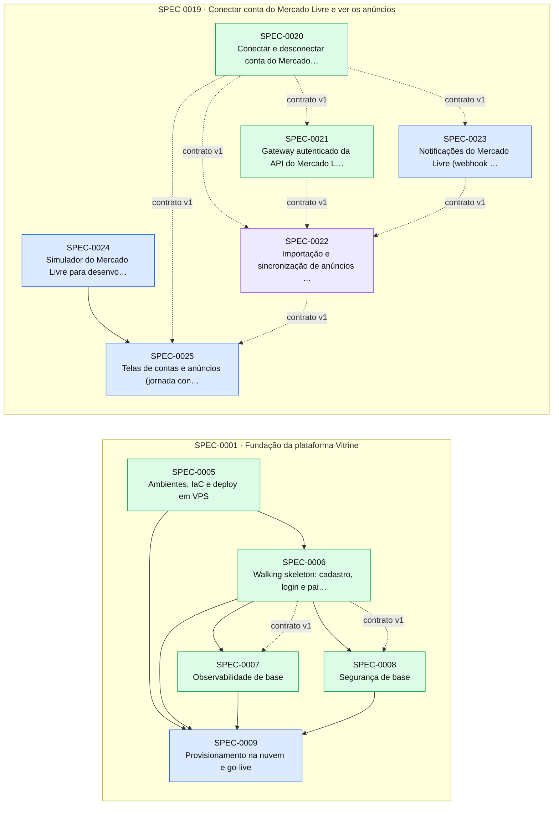

# Índice de Specs

> Gerado por `spec_graph.py index` em 2026-10-30 — não edite manualmente.

## Saúde

- Validação (G0): **0 erro(s), 32 aviso(s)** — rode `spec_graph.py validate`
- Specs: approved 4, in-progress 1, implemented 19
- Impedimentos: **0 aberto(s)**, 10 resolvido(s)

## Cobertura de Pilares

Perfil: **padrao**

| Pilar | Situação | Detalhe |
|---|---|---|
| Arquitetura e fronteiras | coberto | ADR-0001 |
| Estratégia de testes | coberto | ADR-0002, ADR-0016 |
| Qualidade de código | coberto | ADR-0003 |
| Entrega contínua e ambientes | coberto | ADR-0004 |
| Fluxo de mudança | coberto | ADR-0005 |
| Segredos e dados sensíveis | coberto | ADR-0006 |
| Identidade e acesso | coberto | ADR-0007 |
| Dependências e ciclo de vida da stack | coberto | ADR-0008 |
| Observabilidade | coberto | ADR-0009 |
| Resiliência e recuperação | coberto | ADR-0010 |
| Dados e migrações | coberto | ADR-0011 |
| Custo | coberto | ADR-0012 |

## Jornadas Críticas

| Jornada | Situação | Specs |
|---|---|---|
| Vendedor se cadastra, entra e vê o painel | provada | SPEC-0006 |
| Vendedor conecta conta do Mercado Livre e vê os anúncios | descoberta | — |

## Plano de Execução

**Em andamento:** SPEC-0022  
**Paradas por impedimento:** —  
**Próximo lote:** SPEC-0009

| Onda | Spec | Título | Tier/Tam. | Status | Prontidão | Observação |
|---|---|---|---|---|---|---|
| 1 | SPEC-0022 | Importação e sincronização de anúncios (módulo Listings) | full/M | in-progress | 🔄 em andamento |  |
| 1 | SPEC-0009 | Provisionamento na nuvem e go-live | full/M | approved | ✅ pronta |  |
| 2 | SPEC-0023 | Notificações do Mercado Livre (webhook de anúncios) | full/M | approved | ✅ pronta | saiu da onda 1: arquivos em comum com SPEC-0022 |
| 3 | SPEC-0024 | Simulador do Mercado Livre para desenvolvimento e E2E | full/M | approved | ✅ pronta | saiu da onda 1: arquivos em comum com SPEC-0022, SPEC-0009; saiu da onda 2: arquivos em comum com SPEC-0023 |
| 4 | SPEC-0025 | Telas de contas e anúncios (jornada conectar-conta) | full/M | approved | ⛔ aguarda implementação de SPEC-0024 |  |

## Épicos

| Épico | Título | Status | Progresso |
|---|---|---|---|
| SPEC-0001 | Fundação da plataforma Vitrine | approved | 16/17 implementadas |
| SPEC-0019 | Conectar conta do Mercado Livre e ver os anúncios | approved | 3/7 implementadas |

## Grafo de Dependências

Seta contínua: depende da implementação. Seta tracejada: consome contrato.

## Todas as Specs

| ID | Título | Tier | Tipo | Status | Criada | Épico | Depende de | Consome contrato |
|---|---|---|---|---|---|---|---|---|
| [SPEC-0001](SPEC-0001-fundacao-da-plataforma-vitrine.md) | Fundação da plataforma Vitrine | epic | foundation | approved | 2026-10-13 | — | — | — |
| [SPEC-0002](SPEC-0002-repositorio-ferramentas-e-convencoes.md) | Repositório, ferramentas e convenções | full | foundation | implemented | 2026-10-13 | SPEC-0001 | — | — |
| [SPEC-0003](SPEC-0003-harness-de-testes-e-arquitetura.md) | Harness de testes e arquitetura | full | foundation | implemented | 2026-10-13 | SPEC-0001 | SPEC-0002 | — |
| [SPEC-0004](SPEC-0004-pipeline-de-ci.md) | Pipeline de CI | full | foundation | implemented | 2026-10-13 | SPEC-0001 | SPEC-0002 | — |
| [SPEC-0005](SPEC-0005-ambientes-iac-e-deploy-em-vps.md) | Ambientes, IaC e deploy em VPS | full | foundation | implemented | 2026-10-13 | SPEC-0001 | SPEC-0002 | SPEC-0004@2 |
| [SPEC-0006](SPEC-0006-walking-skeleton-cadastro-login-e-painel-vazio.md) | Walking skeleton: cadastro, login e painel vazio | full | foundation | implemented | 2026-10-13 | SPEC-0001 | SPEC-0003, SPEC-0004, SPEC-0005 | — |
| [SPEC-0007](SPEC-0007-observabilidade-de-base.md) | Observabilidade de base | full | foundation | implemented | 2026-10-13 | SPEC-0001 | SPEC-0006 | SPEC-0006@1 |
| [SPEC-0008](SPEC-0008-seguranca-de-base.md) | Segurança de base | full | foundation | implemented | 2026-10-13 | SPEC-0001 | SPEC-0006 | SPEC-0006@1 |
| [SPEC-0009](SPEC-0009-provisionamento-na-nuvem-e-go-live.md) | Provisionamento na nuvem e go-live | full | foundation | approved | 2026-10-13 | SPEC-0001 | SPEC-0005, SPEC-0006, SPEC-0007, SPEC-0008 | — |
| [SPEC-0010](SPEC-0010-avisos-de-seguranca-novos-em-dependencias-quebram-o-build-da.md) | Avisos de segurança novos em dependências quebram o build da main | lite | fix | implemented | 2026-10-28 | SPEC-0001 | — | — |
| [SPEC-0011](SPEC-0011-checagem-de-drift-do-cliente-openapi-no-ci.md) | Checagem de drift do cliente OpenAPI no CI | lite | feature | implemented | 2026-10-28 | SPEC-0001 | — | — |
| [SPEC-0012](SPEC-0012-testes-de-infra-deixam-a-stack-local-rodando.md) | Testes de infra deixam a stack local rodando | lite | fix | implemented | 2026-10-28 | SPEC-0001 | — | — |
| [SPEC-0013](SPEC-0013-excecao-repassada-ao-sentry-com-segredo-repetido-em-propried.md) | Exceção repassada ao Sentry com segredo repetido em propriedade sensível | lite | fix | implemented | 2026-10-28 | SPEC-0001 | — | — |
| [SPEC-0014](SPEC-0014-limitador-sem-particao-por-e-mail-nulo-e-revogacoes-no-check.md) | Limitador sem partição por e-mail nulo e revogações no check do anel | lite | fix | implemented | 2026-10-29 | SPEC-0001 | SPEC-0008 | — |
| [SPEC-0015](SPEC-0015-exception-data-repassado-cru-ao-sentry-em-mechanism-data.md) | Exception.Data repassado cru ao Sentry em mechanism.data | lite | fix | implemented | 2026-10-29 | SPEC-0001 | SPEC-0013 | — |
| [SPEC-0016](SPEC-0016-fixture-de-integracao-nao-libera-pools-do-postgres-compartil.md) | Fixture de integração não libera pools do Postgres compartilhado | lite | fix | implemented | 2026-10-29 | SPEC-0001 | — | — |
| [SPEC-0017](SPEC-0017-checagem-do-anel-aceita-encryptedsecret-fora-do-descritor-da.md) | Checagem do anel aceita encryptedSecret fora do descritor da chave | lite | fix | implemented | 2026-10-29 | SPEC-0001 | SPEC-0014 | — |
| [SPEC-0018](SPEC-0018-mascaramento-do-sentry-ignora-contexts-extras-nao-string-e-v.md) | Mascaramento do Sentry ignora contexts, extras não-string e valores sensíveis de Exception.Data | lite | fix | implemented | 2026-10-29 | SPEC-0001 | SPEC-0015 | — |
| [SPEC-0019](SPEC-0019-conectar-conta-do-mercado-livre-e-ver-os-anuncios.md) | Conectar conta do Mercado Livre e ver os anúncios | epic | feature | approved | 2026-10-30 | — | SPEC-0006, SPEC-0008 | — |
| [SPEC-0020](SPEC-0020-conectar-e-desconectar-conta-do-mercado-livre-oauth-com-pkce.md) | Conectar e desconectar conta do Mercado Livre (OAuth com PKCE) | full | feature | implemented | 2026-10-30 | SPEC-0019 | — | — |
| [SPEC-0021](SPEC-0021-gateway-autenticado-da-api-do-mercado-livre-renovacao-de-tok.md) | Gateway autenticado da API do Mercado Livre (renovação de token e resiliência) | full | feature | implemented | 2026-10-30 | SPEC-0019 | SPEC-0026 | SPEC-0020@1 |
| [SPEC-0022](SPEC-0022-importacao-e-sincronizacao-de-anuncios-modulo-listings.md) | Importação e sincronização de anúncios (módulo Listings) | full | feature | in-progress | 2026-10-30 | SPEC-0019 | — | SPEC-0020@1, SPEC-0021@1, SPEC-0023@1 |
| [SPEC-0023](SPEC-0023-notificacoes-do-mercado-livre-webhook-de-anuncios.md) | Notificações do Mercado Livre (webhook de anúncios) | full | feature | approved | 2026-10-30 | SPEC-0019 | — | SPEC-0020@1 |
| [SPEC-0024](SPEC-0024-simulador-do-mercado-livre-para-desenvolvimento-e-e2e.md) | Simulador do Mercado Livre para desenvolvimento e E2E | full | feature | approved | 2026-10-30 | SPEC-0019 | — | — |
| [SPEC-0025](SPEC-0025-telas-de-contas-e-anuncios-jornada-conectar-conta.md) | Telas de contas e anúncios (jornada conectar-conta) | full | feature | approved | 2026-10-30 | SPEC-0019 | SPEC-0024 | SPEC-0020@1, SPEC-0022@1 |
| [SPEC-0026](SPEC-0026-usefieldprotection-cria-um-provedor-interno-do-ef-por-protet.md) | UseFieldProtection cria um provedor interno do EF por protetor | lite | fix | implemented | 2026-10-30 | SPEC-0019 | SPEC-0020 | — |

## ADRs

| ID | Título | Status | Garantido por (G3) |
|---|---|---|---|
| [ADR-0001](../adr/ADR-0001-arquitetura-e-fronteiras.md) | Arquitetura e fronteiras — monólito modular .NET 10 orquestrado por Aspire | accepted | tests/Vitrine.ArchitectureTests (ArchUnitNET) no CI |
| [ADR-0002](../adr/ADR-0002-estrategia-de-testes.md) | Estratégia de testes | accepted | comandos test, test_integration, test_e2e e arch_test do sdd-config no CI |
| [ADR-0003](../adr/ADR-0003-qualidade-de-codigo.md) | Qualidade de código | accepted | comando lint do sdd-config no CI |
| [ADR-0004](../adr/ADR-0004-entrega-continua-e-ambientes.md) | Entrega contínua e ambientes — GitHub Actions + Docker Compose em VPS | accepted | pipeline GitHub Actions (deploy-staging, deploy-production) e smoke_test do sdd-config (G6) |
| [ADR-0005](../adr/ADR-0005-fluxo-de-mudanca.md) | Fluxo de mudança — PRs no GitHub com merge commit | accepted | proteção da branch main no GitHub + job sdd (pr-check) obrigatório |
| [ADR-0006](../adr/ADR-0006-segredos-e-dados-sensiveis.md) | Segredos e dados sensíveis | accepted | gitleaks no CI (security_scan) + teste de mascaramento de logs + teste de criptografia de tokens |
| [ADR-0007](../adr/ADR-0007-identidade-e-acesso.md) | Identidade e acesso — ASP.NET Core Identity com cookie na mesma origem e workspaces | accepted | teste de arquitetura "endpoints exigem autorização por padrão" + testes de acesso negado por spec |
| [ADR-0008](../adr/ADR-0008-dependencias-e-ciclo-de-vida-da-stack.md) | Dependências e ciclo de vida da stack | accepted | security_scan do sdd-config no CI + Dependabot |
| [ADR-0009](../adr/ADR-0009-observabilidade.md) | Observabilidade — OpenTelemetry com Grafana Cloud e Sentry | accepted | teste de integração do health check + teste de mascaramento de logs (SPEC-0007) |
| [ADR-0010](../adr/ADR-0010-resiliencia-e-recuperacao.md) | Resiliência e recuperação | accepted | teste de restauração registrado (SPEC-0005) + testes de integração de timeout/idempotência |
| [ADR-0011](../adr/ADR-0011-dados-e-migracoes.md) | Dados e migrações — PostgreSQL 18 com EF Core Migrations por módulo | accepted | teste de integração de migrações (SPEC-0003) + job de migração no pipeline (SPEC-0005) |
| [ADR-0012](../adr/ADR-0012-custo.md) | Custo — modelo de custo de infraestrutura e IA | accepted | N/A — revisão mensal registrada em docs/runbooks/custo.md e limites de gasto nos provedores |
| [ADR-0013](../adr/ADR-0013-frontend-spa-react-com-vite.md) | Frontend: SPA React com Vite | accepted | drift do cliente OpenAPI verificado no CI + E2E Playwright em viewport móvel |
| [ADR-0014](../adr/ADR-0014-mensageria-interna-e-jobs-wolverine-com-outbox-no-postgresql.md) | Mensageria interna e jobs: Wolverine com outbox no PostgreSQL | accepted | teste de arquitetura (handlers só no próprio módulo) + teste de integração de durabilidade da fila (SPEC-0003) |
| [ADR-0015](../adr/ADR-0015-provedor-de-ia-claude-opus-5-5-e-sonnet-5-5.md) | Provedor de IA: Claude (Opus 5.5 e Sonnet 5.5) | accepted | teste de arquitetura (só o adaptador de IA referencia o SDK Anthropic) + suíte de avaliação versionada |
| [ADR-0016](../adr/ADR-0016-simulador-do-mercado-livre-para-desenvolvimento-e2e-e-ambien.md) | Simulador do Mercado Livre para desenvolvimento, E2E e ambiente local | accepted | teste de ferramenta (SPEC-0024:IT-03) que reprova o simulador fora de Development/E2E/local + revisão no G4 |
